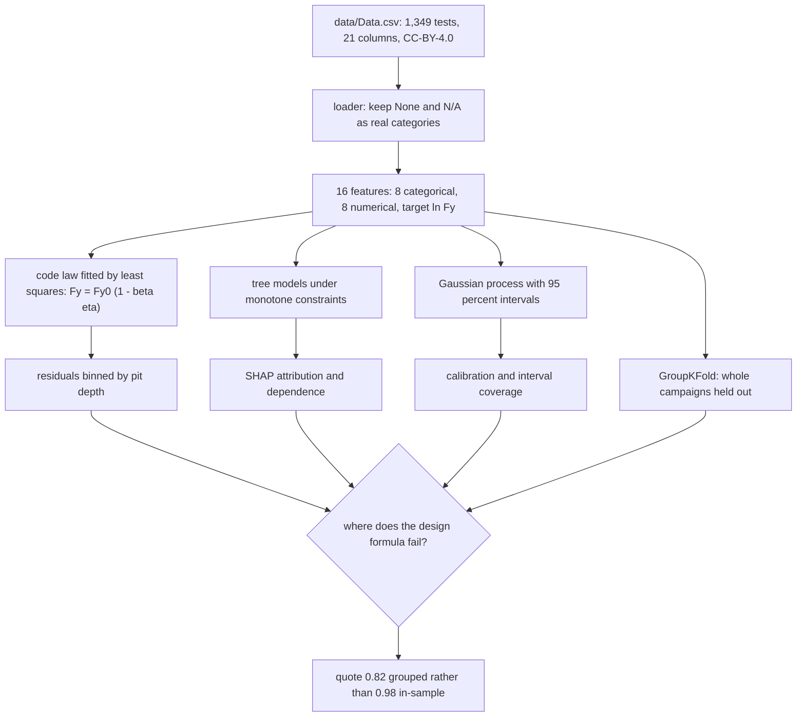
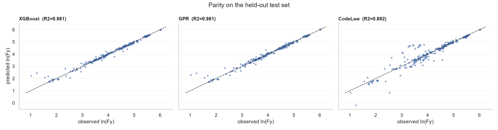
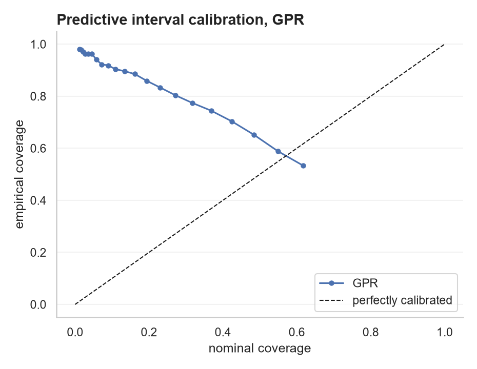
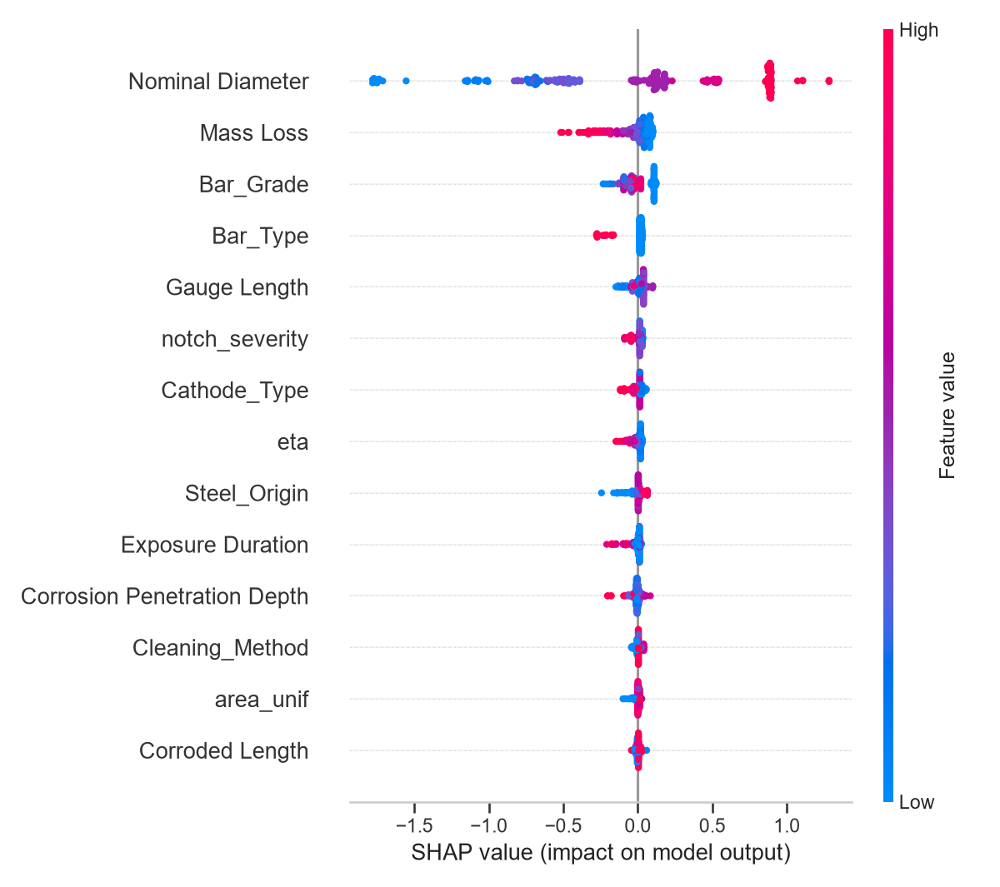
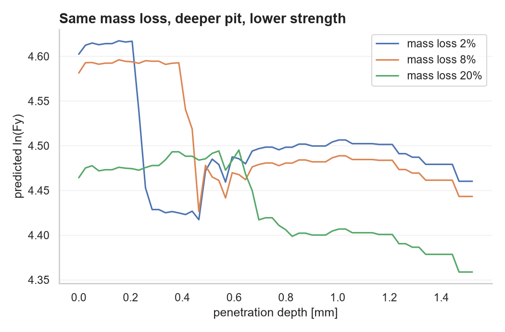

# Corroded steel residual yield force: separating pitting-notch effects from uniform mass loss

Predicting log yield force (kN) for corroded steel bars from 1,349 tensile tests across 26 published campaigns, with the pitting notch effect isolated from uniform thinning three ways.

## What this adds

The source study built the database and compared machine-learning models across nine mechanical properties of corroded bars. It did not interrogate the design formula an assessor actually reaches for, which is a straight line in mass loss. This notebook does that, and reports where the formula fails rather than how well a model scores.

Four results came out of it:

- A properly fitted code law reaches R2 of 0.892 with a degradation factor of 1.602, where a pure area-loss reading implies 1.0. The formula is absorbing damage it has no term for.
- Its error grows with pit depth, from a mean residual of -0.127 in the shallowest depth bin to +0.389 in the deepest, so it overstates sound bars and understates the most pitted ones. That is the opposite direction from what a formula blind to pitting should show.
- Deleting the five pit-depth features costs 0.0012 of R2, which sizes what pitting knowledge is worth in a score averaged over every row. Holding mass loss fixed and moving only depth drops the prediction by 0.142 in log units between no pit and 1.52 mm of pit.
- Holding whole campaigns out drops R2 from 0.981 to 0.820 and multiplies MAPE by five, so 0.820 is the number to quote outside the notebook.

## The route



Three routes to the same question, which is whether the straight-line design formula in mass loss
is describing the damage or hiding it. Fitting the formula and watching its residuals answers it
directly. Modelling the same data without the formula and asking SHAP what the pit-depth family is
worth answers it by subtraction. Holding whole campaigns out answers how much of the result
survives a new source.

## Data and attribution

The database belongs to Benjamin Matthews, Alessandro Palermo and Allan Scott: *Monotonic Tensile Testing of Corroded Reinforcing Steel Bars Database*, Zenodo, 2023, doi [10.5281/zenodo.8035720](https://doi.org/10.5281/zenodo.8035720), released under CC-BY-4.0. The copy used here, and the model comparison it shipped with, comes from [bma114/corroded-steel-machine-learning](https://github.com/bma114/corroded-steel-machine-learning). The published article is Matthews, Palermo, Logan and Scott, *Construction and Building Materials* 438, 2024, doi [10.1016/j.conbuildmat.2024.137023](https://doi.org/10.1016/j.conbuildmat.2024.137023).

Data.csv is redistributed here under CC-BY-4.0 with the attribution above. The file is byte-identical to the copy in the repository named above, and no column was altered.

Everything beyond Data.csv, which is `src/pipeline.py`, the notebook, the figures and the results file, is my own work and is released under the MIT licence in LICENSE.

8 categoricals (specimen type, load history, bar type, steel origin, grade, corrosion method, cathode, cleaning) + 8 numericals (diameter, gauge length, current density, exposure, solution concentration, mass loss, corroded length, penetration depth). Target ln(Fy), 2.8 to 417 kN.

## Results (held-out 20%, fixed seeds)

| Model | R2 | MAPE (kN) |
|---|---|---|
| Code law Fy0(1-beta eta), beta = 1.60 | 0.892 | 22.1% |
| XGBoost (monotone-constrained) | 0.981 | 7.5% |
| GPR (PICP95 0.959) | 0.981 | 7.7% |
| LightGBM / RF | 0.979 / 0.978 | 8.3 / 8.8% |
| XGB without pit-depth family | 0.980 | 7.6% |
| XGB, grouped by campaign (unseen) | 0.820 | 37.8% |

10-fold CV ranking agrees: XGB 0.990, GPR 0.989, LightGBM 0.987, RF 0.986, MLP 0.971, MLR 0.964.

## Figures



Parity on the held-out fifth. The code law tracks the middle of the range and loses the ends,
which is where an assessor needs it most.



Interval calibration for the Gaussian process. The 95 percent intervals cover 95.9 percent of the
held-out rows, so the uncertainty is usable rather than nominal.



Attribution of the boosted model, run on the held-out rows. The pit-depth family is the part of the
input the design formula cannot see, and deleting those five features costs only 0.0012 of R2 in a
score averaged over every row.



The same question asked directly: how the prediction moves with penetration depth while the other
features stay where they were observed. Holding mass loss fixed and moving only depth changes the
prediction by 0.142 in log units between no pit and 1.52 mm of pit.

## Equations

The design formula as an assessor writes it, with the degradation factor fitted rather than
assumed. The target is the natural log of the yield force, so the fit is linear in log space:

$$F_y = F_{y0}\left(1 - \beta\,\eta\right), \qquad \ln F_y = \ln F_{y0} + \ln\left(1 - \beta\,\eta\right)$$

where $\eta$ is the mass-loss ratio and the fitted $\beta$ is 1.602 against the 1.0 that reading
the formula as pure area loss would imply.

Scoring, on the held-out fifth and again under campaign grouping:

$$R^2 = 1 - \frac{\sum_i (y_i - \hat{y}_i)^2}{\sum_i (y_i - \bar{y})^2}, \qquad
\mathrm{MAPE} = \frac{100}{n}\sum_i \left|\frac{y_i - \hat{y}_i}{y_i}\right|$$

Interval coverage, the share of held-out rows inside the predicted 95 percent band:

$$\mathrm{PICP} = \frac{1}{n}\sum_i \mathbb{1}\left[\,l_i \leq y_i \leq u_i\,\right]$$

Attribution, which is where the second result comes from. SHAP values are Shapley values of the
model treated as a cooperative game, and they add up to the prediction exactly:

$$\phi_j = \sum_{S \subseteq N \setminus \{j\}} \frac{|S|!\,(|N| - |S| - 1)!}{|N|!}
\left[f(S \cup \{j\}) - f(S)\right], \qquad f(x) = \mathbb{E}[f(X)] + \sum_j \phi_j(x)$$

The tree models carry monotone constraints, so the fitted response cannot bend back on itself in
directions the metallurgy fixes:

$$\frac{\partial f}{\partial x_j} \geq 0 \quad \text{for the features where increasing the value
can only increase the yield force}$$

## Methods and tools

- **numpy and pandas** for the loader and the feature assembly. The loader treats `None` and `N/A`
  as real categories, because pandas reads them as missing and that silently drops rows.
- **scikit-learn** for the Gaussian process, the random forest, the multilayer perceptron and the
  linear baseline, and for `GroupKFold`, which keeps whole campaigns on one side of the split.
- **XGBoost and LightGBM** for the boosted trees, with monotone constraints on the features whose
  direction is known, and fixed seeds so the table is reproducible.
- **SHAP** for the attribution and the dependence plots, run on the held-out rows rather than the
  training rows.
- **matplotlib** for the figures, all written to `figures/` by `src/pipeline.py`.
- **The pipeline runs headless** (`python src/pipeline.py`, about five minutes) and writes
  `results/results.json`, which is what the notebook quotes, so the numbers in this README can be
  regenerated rather than trusted.

### Why a re-run may differ in the last digit

The table comes from the run stored in the notebook, on numpy 2.4.6, pandas 3.0.5, xgboost 3.2.0, lightgbm 4.7.0 and shap 0.51.0. Google Colab and Kaggle ship other versions of the tree libraries, and I have now run this on Kaggle to see what moves. The code law's degradation factor of 1.602, the depth-residual correlation of +0.308 and the interval coverage of 0.959 came out identical. XGBoost's held-out R2 landed at 0.983 instead of 0.981, and the campaign-grouped R2 at 0.788 instead of 0.820. The conclusions do not turn on either decimal, but quote the grouped figure as 0.79 to 0.82 rather than as a constant, and pin the versions if you need to match the table exactly.

## Layout

```
data/Data.csv                       the 1,349-test database, 21 columns
src/pipeline.py                     CV, model fits and figures, headless, about five minutes
notebooks/corroded_steel_ML.ipynb   the write-up, 60 cells, outputs stored
figures/                            parity, notch residuals, partial dependence, SHAP, calibration
results/results.json                the numbers the notebook quotes
requirements.txt
```

## Run it

[](https://colab.research.google.com/github/daniswaramp/corroded-steel-yield-force/blob/main/notebooks/corroded_steel_ML.ipynb)

The badge opens the notebook in Google Colab, where the first cell clones this repository, changes into it and installs anything the image lacks. The same notebook also runs on Kaggle, reading the data from a private dataset attached to it, because internet in a Kaggle notebook needs phone verification on the account. Nothing has to be installed by hand on either platform.

Locally:

```bash
python -m venv .venv
.venv/Scripts/pip install -r requirements.txt
.venv/Scripts/python src/pipeline.py
.venv/Scripts/jupyter notebook notebooks/corroded_steel_ML.ipynb
```

## Notes

- The loader keeps 'None' and 'N/A' as real categories, since pandas would read them as missing. ARD-GPR was tried and cut at over seven minutes per fit, so the isotropic kernel keeps the intervals cheap.
- Depth is one number per bar, the deepest point, not pit geometry. Pit count, spacing and shape are absent from this database, which is why the notebook states what it cannot tell.
